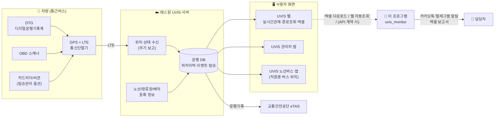
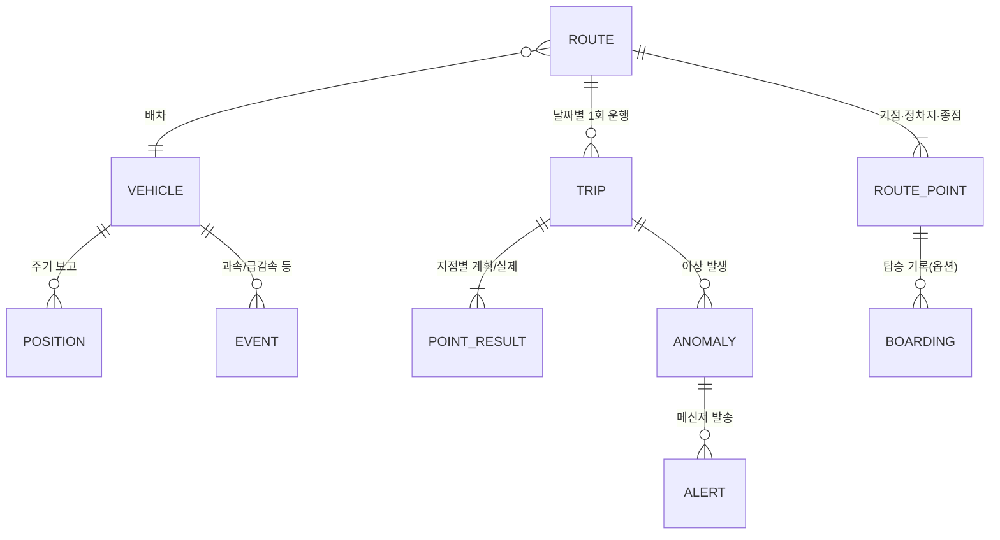
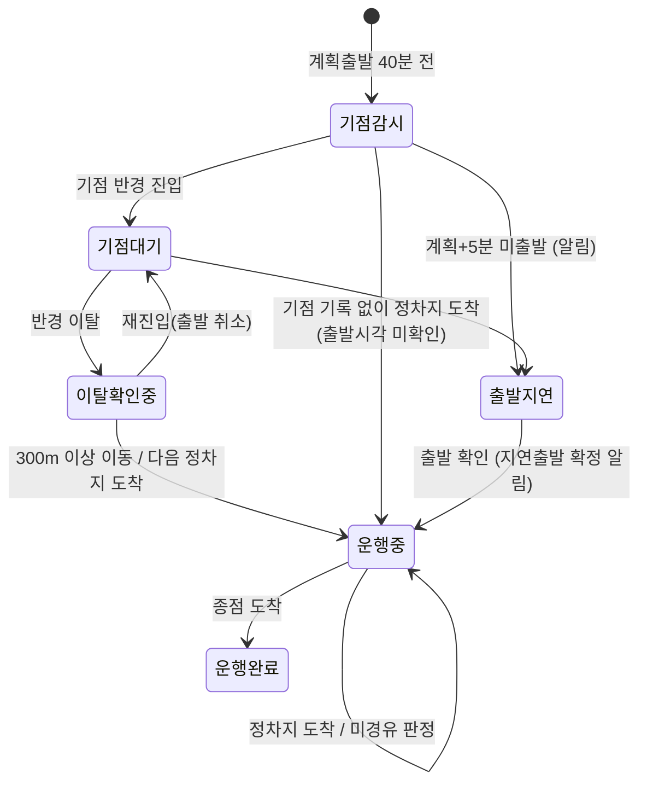

# 에스원 UVIS(유비스) 차량운행관리시스템 분석

> 이 문서는 UVIS의 공개 자료를 바탕으로 정리한 **개발자용 분석서**입니다. 앞으로 UVIS 데이터로 어떤 프로그램을 만들든 이 문서의 개념(데이터 모델, 판정 로직, 연동 방식)을 출발점으로 쓸 수 있게 정리했습니다.
>
> 표기 기준: ✅ **공개자료 확인** · 🔶 **추정**(일반적인 차량관제 시스템 구조로 미루어 본 것) · ❓ **본인 계정으로 확인 필요**
>
> ※ 사용자분은 'UBIS'라고 하셨는데, 에스원의 정식 서비스명은 **UVIS(유비스)** 입니다.
>
> ✅ **2026-10-29 실계정 확인 결과는 [05_UVIS_실제구조_분석](05_UVIS_실제구조_분석.md)** 에 있습니다. 아래 ❓ 항목 중 로그인·실시간 위치·노선/정류장·보고 주기는 그 문서로 확인되었습니다.

---

## 1. 한눈에 보기

| 구분 | 내용 | 근거 |
|---|---|---|
| 서비스명 | 에스원 UVIS(유비스) 차량운행관리 | ✅ 공식 사이트 s1uvis.co.kr, s1.co.kr |
| 운영사 | 에스원(S-1, 삼성 계열 보안회사) | ✅ |
| 한 줄 정의 | 차량에 통신단말기·DTG·GPS를 달아 **실시간 위치·운행상태를 PC/스마트폰으로 관제**하는 서비스 | ✅ |
| 적용 차종 | 버스·화물차, 렌터카·법인차, **통근·통학버스**(노선·위치·탑승관리), 배달 오토바이 등 | ✅ |
| 웹 | www.s1uvis.co.kr (관제·조회), shuttle.u-vis.com (셔틀버스 장비관리) | ✅ |
| 모바일 앱 | 에스원 UVIS(관리자용), **에스원 UVIS 노선버스**(직원 탑승객용), 삼성통근버스(에스원 개발) | ✅ 앱스토어 |
| 고객센터 | 1544-3112 | ✅ 앱 설명 |
| 외부 연계 | 운행기록 → UVIS 서버 → 교통안전공단 **eTAS** 자동 전송 | ✅ |
| 공개 API | 공개 문서는 없음. 단, 로그인 후 고객지원 메뉴에 **API신청**(apiList.do)이 있음 | ✅ 메뉴 존재 확인 / ❓ 조건 미확인 |

---

## 2. 시스템 구성 (아키텍처)

### 2.1 차량 장비 ✅
| 장비 | 역할 | 이 프로그램에서의 의미 |
|---|---|---|
| 통신단말기(LTE) + GPS | 위치·속도를 주기적으로 서버에 보고 | **모든 판정의 원천 데이터** |
| DTG(디지털 운행기록계) | 속도·RPM·브레이크·GPS 법정 기록 (사업용 차량 의무) | eTAS 제출용, 과속·급가감속 이벤트 |
| OBD 스캐너 | 차량 상태(시동, 연비, 고장코드) | 시동 ON/OFF → 위치 보고 여부에 영향 🔶 |
| 카드리더 / 비콘 / 키오스크 | 통근버스 탑승자 인식 (커스터마이징, 에스원 카드 연동) | 정류장별 탑승인원·탑승시각 |
| 블랙박스 연계 | 사고 시 증거, 충격·흔들림 감지 | 사고/급정거 이벤트 |

🔶 **위치 보고 주기**: 일반적인 차량관제 단말은 운행 중 10초~1분, 시동 OFF 시 보고 중단 또는 장주기입니다. 본인 계정의 '경로조회' 화면에서 점 간격을 보면 실제 주기를 알 수 있습니다 ❓.

### 2.2 소프트웨어 기능 ✅ (공개자료 기준)
| 영역 | 기능 |
|---|---|
| 실시간 관제 | 차량별/전체 차량 현재 위치, 운행 상태(운행·정차·시동) |
| 경로 조회 | 일자·시간·차량별 운행경로(지도 궤적) |
| 이벤트 이력 | 과속, 급가속·급감속(급출발·급제동), 공회전 횟수/시간, 과다 RPM, 위치 |
| 에코/안전 리포트 | 운전자별 '에코지수' 점수화 (공회전·과속·경제운전·관성운전·급출발·급제동·RPM) |
| 운행일지 | 운행기록 자동 정리, 국세청 '업무용 승용차 운행기록부' 양식 자동 생성 |
| 통근버스 | **정류장·노선·배차 등록**, 차량별 운행일정 사전 등록, **정류장별 탑승자·탑승시각 자동 기록**, 탑승 현황 조회 |
| 직원용 앱 | 노선별 현재 버스 위치, 노선별 시간표, 즐겨찾기, 공지사항 |
| 승하차 알림 | (어린이 통학) 정류장 지정, 노선 관리, 실시간 위치, 승하차 푸시 |
| 장비관리 | (shuttle.u-vis.com) 비콘·스캐너 현황, 사용 노선 관리, 키오스크 관리 |
| 데이터 반출 | **엑셀 다운로드**, 모바일 모니터링 |
| 법정 연계 | 운행기록 → eTAS 자동 전송 |

### 2.3 UVIS에 '없는'(공개적으로 확인되지 않은) 것 — 이 프로그램이 채우는 부분
- ❓ **노선별 정시성 자동 판정**(기점 출발 N분 지연, 정차지 N분 지연)과 그 **메신저 알림**
- ❓ **이상 내역의 일일/월간 엑셀 보고서** 자동 생성
- ❓ 외부 프로그램이 쓸 수 있는 **공개 API**

UVIS 안에 '노선 운행 현황'이나 '지연 알림' 메뉴가 이미 있을 수도 있습니다. 본인 계정으로 메뉴를 확인해 보시고, 있다면 그 데이터를 직접 받아 쓰는 쪽이 더 정확합니다(4장의 연동 방식 ③).

---

## 3. 데이터 모델 (개념) — 프로그래밍의 기준

UVIS 화면·엑셀·앱에서 보이는 정보를 프로그램이 다루기 좋은 형태로 정리하면 다음과 같습니다. 이 저장소의 `uvis_monitor/models.py`가 이 모델을 그대로 구현합니다.

| 개체 | 주요 필드 | 출처 | 비고 |
|---|---|---|---|
| **차량 VEHICLE** | 차량번호(예: 경기70아1234), 차량명(예: 1호차), 단말번호 | UVIS 차량관리 | 화면/엑셀마다 '차량번호' 또는 '차량명'으로 표시 ❓ |
| **위치 POSITION** | 차량, **수신일시**, **위도**, **경도**, 속도, 방향, 시동상태, 주소 | 실시간관제·경로조회·엑셀 | 핵심 데이터. 좌표는 WGS84(일반 지도 좌표) 🔶 |
| **이벤트 EVENT** | 차량, 일시, 종류(과속/급가속/급감속/공회전), 위치 | 이벤트 이력 | 안전운전 분석용 |
| **노선 ROUTE** | 노선명, 운행 구분(출근/퇴근), 운행 요일 | UVIS 노선 등록 | 이 프로그램은 `routes.yaml`에 정의 |
| **지점 ROUTE_POINT** | 순번, 이름, 위도·경도, **계획시각**, 반경 | UVIS 정류장 등록 | 기점 → 정차지들 → 종점 |
| **배차** | 날짜, 노선, 차량, 기사 | UVIS 배차 등록 | 대차(차량 교체) 시 vehicle_id 변경 |
| **운행 TRIP** | 날짜 × 노선 1회 | 이 프로그램 | 상태: 대기 → 운행중 → 완료 |
| **지점 결과 POINT_RESULT** | 계획시각, 실제시각, 편차(분), 판정 | 이 프로그램 | 엑셀 '노선별상세' |
| **이상 ANOMALY** | 구분, 지점, 계획/실제, 지연(분), 상태(진행중/확정/해제) | 이 프로그램 | 엑셀 '이상발생내역' |
| **탑승 BOARDING** | 정류장, 탑승자, 탑승시각 | UVIS 탑승관리(옵션) | 탑승률 분석 확장 시 |

### 3.1 엑셀 다운로드 열 이름 (예상) 🔶
UVIS 경로조회 엑셀의 정확한 열 이름은 확인되지 않았습니다. 프로그램은 아래 이름들을 **자동 인식**하고, 다르면 설정으로 지정할 수 있습니다.

| 필드 | 자동 인식하는 열 이름 |
|---|---|
| 차량 | 차량번호, 차번, 차량명, 차량, 단말기번호 … (없으면 파일명에서 차량번호 추출) |
| 시각 | 수신일시, 발생일시, GPS일시, 운행일시, 일시, 시간, 시각 … (일자+시간 열 분리도 지원) |
| 위도/경도 | 위도/경도, lat/lng, latitude/longitude, Y좌표/X좌표 |
| 속도/주소 | 속도, 속도(km/h), 주행속도 / 주소, 위치, 현재위치 |

→ 실제 파일을 받으면 `python -m uvis_monitor inspect-excel 파일.xlsx`로 바로 확인됩니다.

---

## 4. 데이터를 가져오는 방법 (연동 방식 비교)

UVIS는 공개 API가 확인되지 않으므로, 현실적인 방법은 다음 네 가지입니다.

| 방식 | 실시간성 | 안정성 | 난이도 | 비고 |
|---|---|---|---|---|
| ① **에스원 공식 연동(API/데이터 제공) 요청** | ◎ | ◎ | 하 (요청만) | 가장 바람직. 계약 고객이면 협의 가능성 있음 ❓ |
| ② **UVIS 웹 자동조회** (본인 계정, 브라우저 자동화) | ○ (1분 주기) | △ (화면 개편 시 수정 필요) | 중 | 이 프로그램의 `uvis_web` 소스. `web-probe`로 구조 파악 |
| ③ UVIS 화면의 **노선 운행현황/도착정보** 직접 활용 | ○ | ○ | 중 | 메뉴가 있다면 정류장 도착시각을 직접 받음 ❓ |
| ④ **엑셀 다운로드 후 분석** | × (사후) | ◎ | 하 | `replay` 명령. 자동 다운로드와 조합하면 준실시간 |

**권장 순서**: 지금 바로 ④로 검증 → ②로 실시간 감시 운영 → 동시에 ①을 요청해 두고, 승인되면 `http_api` 소스로 교체합니다. 요청 문안은 [02_데이터연동_가이드.md](02_데이터연동_가이드.md)에 있습니다.

---

## 5. 노선 운행 감시의 핵심 개념 (판정 로직)

### 5.1 지오펜스(Geofence)
각 지점(기점·정차지·종점)을 **중심 좌표 + 반경(m)** 의 원으로 봅니다. 차량 위치가 원 안에 들어오면 '도착', 원 밖으로 나가면 '이탈'입니다.
- GPS 오차는 도심 10~30m, 고층건물 사이 50m 이상도 나므로 **반경은 100~200m** 를 권장합니다.
- 정류장 좌표가 실제 버스가 서는 곳과 다르면 '미경유' 오판이 생깁니다. 처음 1~2주는 결과를 보며 좌표와 반경을 다듬어야 합니다.

### 5.2 샘플 사이 보간 (빠른 통과 감지)
위치가 1분마다 오면, 시속 40km 버스는 그 사이 약 670m를 움직입니다. 그래서 **직전 위치→현재 위치 선분이 원과 만나는지**를 계산하고, 만나는 지점의 시각을 비율로 계산합니다(`geo.segment_circle`). 이렇게 하면 7분 간격 데이터로도 정류장 통과를 놓치지 않습니다(테스트로 검증).

### 5.3 출발 판정
1. 계획 출발 **40분 전**부터 기점을 감시합니다(그 전 위치는 무시).
2. 기점 반경 안에 있다가 밖으로 나간 **경계 통과 시각**을 '출발시각'으로 봅니다.
3. 오탐을 막기 위해, 기점에서 **300m 이상 멀어지거나 다음 정차지에 도착**해야 출발로 **확정**합니다.
   - 기점 근처를 맴돌거나 다시 들어오면 출발을 취소합니다.
   - 계획보다 **일찍 이탈**한 경우(차고지 오가며 기점을 스쳐 지나감)는 실제로 다음 정차지 쪽으로 가야 확정합니다.
   - 기점으로 오는 길(공차 회송)에 정차지를 먼저 지나쳐도, 계획시각보다 20분 넘게 이르면 출발로 보지 않습니다.

### 5.4 판정 기준 (이 프로그램 기본값, `config.yaml`의 `rules`)
| 상황 | 기준 | 판정 | 알림 시점 |
|---|---|---|---|
| 기점 미출발 | 계획 출발 + **5분** 경과 | 🚨 출발지연 | **즉시**(06:30 계획이면 06:35에) |
| 기점 지연 출발 | 실제 출발 ≥ 계획 + 5분 | 출발지연 확정 | 출발 확인 시 |
| 기점 조기 출발 | 실제 출발 ≤ 계획 − 3분 | ⚠️ 조기출발 | 출발 확인 시 |
| 정차지 미도착 | 계획 도착 + **10분** 경과 | 🚨 정차지연 | **즉시** |
| 정차지 지연 도착 | 실제 ≥ 계획 + 10분 | 정차지연 확정 | 도착 확인 시 |
| 정차지 미경유 | 다음 지점에 먼저 도착 | ⚠️ 미경유 | 다음 지점 도착 시 |
| 위치 미수신 | 운행 중 10분 이상 위치 없음 | ⚠️ 위치미수신 | 즉시 / 재개 시 ✅ |
| 주의 | 출발 3~4분, 정차 5~9분 지연 | ▲ 주의 | 보고서에만 표시 |

- 지연(분)은 **소수점 이하 버림**으로 판정합니다(4분 59초 = 4분 → 정상).
- '미출발 알림'을 보냈는데 실제로는 기준 안에 출발한 것으로 확인되면(데이터 지연 등) **해제** 처리하고 ✅ 알림을 보냅니다.
- 같은 알림은 하루 한 번만 보냅니다. 프로그램이 재시작돼도 DB를 보고 중복 발송하지 않습니다.

### 5.5 상태 기계 (노선 1회 운행)

---

## 6. 운영상 주의점

### 6.1 법·보안 ⚠️
- **위치정보법**: 차량 위치가 특정 운전기사와 연결되면 개인위치정보로 볼 수 있습니다. 회사가 이미 UVIS로 관제하고 있다면 관련 동의 절차가 있을 가능성이 높지만, 이 프로그램으로 **알림·보고서를 추가로 만들고 메신저로 보내는 것**이 그 동의 범위인지 회사 담당 부서와 확인하세요.
- **계정·약관**: UVIS 계정을 자동화 프로그램에 쓰는 것이 에스원 이용약관과 회사 보안정책에 맞는지 확인하세요. 비밀번호는 `.env` 파일에만 두고, 이 파일은 공유하지 마세요.
- **메신저 보안**: 카카오톡/텔레그램으로 나가는 메시지에는 차량번호·기사명·위치가 들어갑니다. 개인 휴대폰의 '나와의 채팅'이나 본인만 있는 채팅방으로만 보내도록 설정되어 있습니다.
- **조회 주기**: 60초 이상을 권장합니다. 너무 잦은 조회는 에스원 서버에 부담을 주고 계정이 차단될 수 있습니다.

### 6.2 데이터 품질
| 현상 | 원인 | 대응 |
|---|---|---|
| 기점에서 위치가 안 잡힘 | 시동 OFF 상태로 대기(단말 보고 중단) | 첫 위치가 정차지면 '출발시각 미확인'으로 처리 |
| 정류장 미경유 오판 | 좌표 오차, 반경이 작음, 실제 정차 위치 다름 | 반경 확대(150~250m), 좌표 수정 |
| 도착시각이 들쭉날쭉 | 보고 주기가 길거나 통신 지연 | 보간 처리, 긴 공백 구간은 '추정' 표시 |
| 터널·지하차도 | GPS 단절 | 10분 미만이면 무시, 이상이면 위치미수신 알림 |
| 차량 교체(대차) | 예비차 투입 | 당일 `routes.yaml`의 vehicle_id 변경(데몬은 매일 다시 읽음) |

---

## 7. 이 분석으로 더 만들 수 있는 프로그램 (확장 아이디어)

| 아이디어 | 필요한 데이터 | 이 저장소에서 시작점 |
|---|---|---|
| 퇴근 노선 감시 | 퇴근 노선 정의 | `routes.yaml`에 퇴근 노선 추가 + 감시 시간대 하나 더 |
| 정류장 **도착 예정시각(ETA)** 안내 | 위치 + 과거 구간 소요시간 | `storage.positions()`로 과거 궤적 → 구간별 평균 |
| 상습 지연 구간 분석 | 월간 point_results | `point_results` 테이블 → 정류장별 지연 분포 |
| 노선 시간표 최적화 | 3개월치 실제 도착시각 | 정류장별 실제 도착 85% 지점으로 계획시각 재설정 |
| 탑승률·노선 통폐합 검토 | UVIS 탑승관리 데이터 | 엑셀 소스에 탑승 레코드 추가 |
| 안전운전 리포트 | UVIS 이벤트 이력(과속·급감속) | 새 소스 + 기사별 집계 |
| 기사 근태(출근 시각) | 첫 위치 수신 시각 | `positions` 테이블 |
| 대시보드 웹페이지 | DB | SQLite → 간단한 웹 화면 |

새 기능을 붙이는 방법은 [README](../README.md)의 '구조와 확장'을 보세요.

---

## 8. 본인 계정으로 확인할 것 (체크리스트) ❓
- [ ] UVIS 웹 로그인 주소, 로그인 입력칸, 추가 인증(OTP 등) 여부
- [ ] '실시간 관제' 화면 주소와 자동 새로고침 주기
- [ ] '경로조회' 엑셀의 열 이름 (→ `inspect-excel`)
- [ ] 차량 표시 이름(차량번호 vs 차량명) → `routes.yaml`의 vehicle_id와 일치시킬 값
- [ ] 위치 보고 주기(경로조회 점 간격), 시동 OFF 시 보고 여부
- [ ] 통근버스 메뉴(정류장/노선/배차)에 등록된 정류장 좌표 → `routes.yaml`로 옮기기
- [ ] '노선 운행현황/도착정보' 같은 메뉴 존재 여부 (있으면 연동 방식 ③)
- [ ] 회사 보안정책·에스원 약관상 자동조회 허용 여부, 에스원 API 제공 가능 여부

---

## 참고 자료
- 에스원 공식: [차량운행관리 사업소개](https://www.s1.co.kr/channel/car-running-manage/car-running-management) · [버스/화물차](https://www.s1.co.kr/channel/car-running-manage/bus-freight) · [렌터카/법인차](https://www.s1.co.kr/channel/car-running-manage/rent-corp-car) · [디지털 쇼룸(UVIS)](https://www.s1.co.kr/showroom/uvis)
- UVIS 사이트: [s1uvis.co.kr](https://www.s1uvis.co.kr/) · [운송관리](https://www.s1uvis.co.kr/%EC%9A%B4%EC%86%A1%EA%B4%80%EB%A6%AC) · [셔틀버스 장비관리](https://shuttle.u-vis.com/)
- 앱: [에스원 UVIS 노선버스(iOS)](https://apps.apple.com/kr/app/%EC%97%90%EC%8A%A4%EC%9B%90-uvis-%EB%85%B8%EC%84%A0%EB%B2%84%EC%8A%A4/id691090004) · [노선버스(Android)](https://play.google.com/store/apps/details?id=com.s1.uvisbus.external) · [에스원 UVIS(iOS)](https://apps.apple.com/kr/app/%EC%97%90%EC%8A%A4%EC%9B%90-uvis/id1476776589) · [에스원 UVIS(Android)](https://play.google.com/store/apps/details?id=kr.co.s1.uvis) · [삼성통근버스](https://apps.apple.com/kr/app/%EC%82%BC%EC%84%B1%ED%86%B5%EA%B7%BC%EB%B2%84%EC%8A%A4/id1484918398)
- 기사: [대한금융신문 – 유비스 각광](https://www.kbanker.co.kr/news/articleView.html?idxno=204371) · [아시아경제 – 유비스로 안전운전(2021)](https://www.asiae.co.kr/article/2021030810375015149) · [한국금융경제신문](https://www.kfenews.co.kr/news/articleView.html?idxno=605226) · [뉴데일리 – 에코지수(2016)](https://biz.newdaily.co.kr/site/data/html/2016/11/01/2016110110115.html)

> 공개 자료 대부분이 2016~2021년 것이라 현재 화면·기능과 다를 수 있습니다. 위 체크리스트로 본인 계정에서 확인한 내용을 이 문서에 덧붙여 두면, 이후 개발의 정확도가 올라갑니다.
