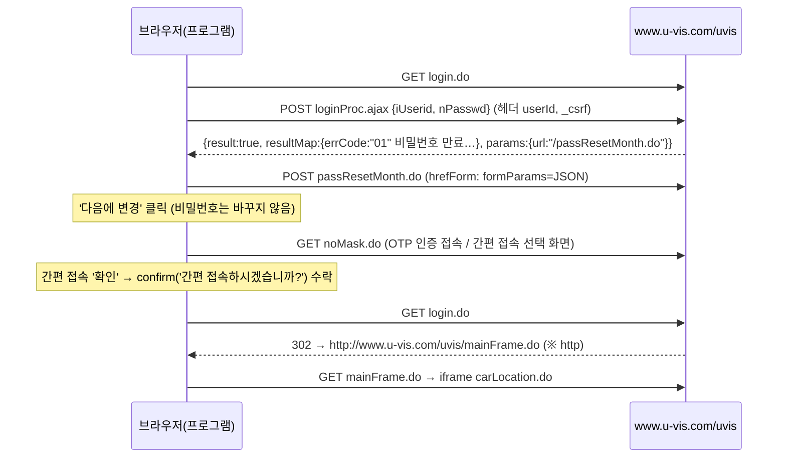

# UVIS 실제 구조 분석 (2026-10-29 실계정 확인)

> [01_UVIS_시스템_분석](01_UVIS_시스템_분석.md)이 공개자료를 바탕으로 쓴 개념서라면, 이 문서는 **실제 계정으로 로그인해 확인한 화면·요청·응답 구조**입니다. UVIS 데이터를 다루는 기능을 만들 때 이 문서를 기준으로 삼으세요.
>
> - 확인 일시: 2026-10-29 16:00~16:40 (KST), 관리자 계정 1개, 헤드리스 Chromium
> - 표기: ✅ 실제 확인 · 🔶 추정(값 분포로 미루어 본 것) · ❓ 아직 확인 안 함
> - 계정·토큰·실제 차량번호·정류장명·좌표는 싣지 않았습니다. 예시 값은 **형식만 같은 가짜 값**입니다.

---

## 1. 한눈에 보기

| 항목 | 내용 |
|---|---|
| 서비스 주소 ✅ | `https://www.u-vis.com/uvis/` (로그인 `login.do`). 예전 문서의 `s1uvis.co.kr`은 `www.s1uvis.co.kr`로 넘겨주는 별도 도메인 |
| 화면 구조 ✅ | jQuery + jqGrid. 메인 `mainFrame.do` 안에 메뉴마다 **iframe 탭**이 열림 (첫 탭 = 실시간모니터링 > 차량위치 `carLocation.do`) |
| 요청 방식 ✅ | 대부분 `POST` + JSON 본문(`application/json`). 헤더에 `userId`, `_csrf`(JWT, **화면 HTML에 박혀 있음**) |
| 실시간 위치 ✅ | `POST /uvis/carLocationVehicleList.ajax` → `carList[]` (차량 1대당 75개 필드). 화면은 30초마다 자동 갱신 |
| 단말 보고 주기 ✅ | 운행 중 차량은 **약 60초**마다 위치 갱신 (`biTime`이 1분 단위로 증가) |
| 노선·정류장 ✅ | UVIS에 **노선·정류장·배차(출발/종료 시각, 요일, 배정 차량)가 등록되어 있음** → `import-routes`로 routes.yaml 자동 생성 |
| 추가 인증 ✅ | 로그인 후 **비밀번호 만료 안내** → **OTP 인증 또는 간편 접속** 화면. 간편 접속은 OTP 없이 들어가되 상세 개인정보만 가려짐 |
| 지도 ✅ | 카카오맵 SDK(`dapi.kakao.com`). 막힌 환경에서는 화면이 첫 조회를 하지 않음 → 프로그램이 `getDataLoad()`를 직접 호출 |
| 공식 API ❓ | 고객지원 메뉴에 **`API신청`(apiList.do)** 이 있음. 내용·조건은 아직 확인 안 함 → 운영 안정화 단계에서 검토 |

---

## 2. 로그인 흐름 ✅



| 단계 | 화면 | 입력칸 / 버튼 | 비고 |
|---|---|---|---|
| 로그인 | `login.do` | `#iUserid`, `#nPasswd`, `.btn-login` | 폼 submit 이 아니라 `loginProc.ajax` 로 JSON 전송. 실패 시 `#loginMsg`에 사유 |
| 비밀번호 만료 안내 | `passResetMonth.do` | `button:has-text('다음에 변경')` | `errCode "01"`. 이 화면에도 `#nPasswd`(새 비밀번호)가 있어 **로그인 실패로 오인하기 쉬움** |
| 추가 인증 | `noMask.do` | 간편 접속 `#btnCancel` + 확인창 | OTP 인증은 등록 휴대폰 문자 6자리(180초). 안내문: "OTP 인증을 하지 않은 경우 상세 개인정보(사용자 이름, 휴대폰 번호)를 확인할 수 없습니다" |
| 세션 만료 | 모든 화면 | – | 응답이 `<script>window.top.location.href='/uvis/logout.do?mode=sessionExpire'</script>` → `302 http://…/login.do` → 대화상자 "장시간 미사용으로 로그아웃 되었습니다" |

- **http 로 돌려보냄**: 간편 접속·세션 만료 때 서버가 `http://` 주소로 302 를 보냅니다. 일반 PC에서는 문제없지만 http 가 막힌 환경(클라우드, 일부 사내망)에서는 이동이 실패합니다 → 프로그램은 실패한 http 주소를 https 로 다시 엽니다(`uvis_web._recover_http`).
- **쿠키 재사용**: 한 번 로그인하면 `data/uvis_web_state.json`에 쿠키를 저장해 다음 실행에서 바로 `mainFrame.do`로 들어갑니다.
- 로그인 응답 `resultMap`에는 계정 정보와 **기능 플래그**(`realTimeYn`, `schoolBusYn`, `geofenceFlag`, `newBusappFlag`, `refreshTime` 등 약 100개)가 옵니다. 비밀번호 해시·휴대폰 번호도 들어 있으므로 **로그·파일에 남기지 마세요**.

---

## 3. 공통 요청 규칙 ✅

```js
$.restful({ url: "/uvis/xxx.ajax",
            header: { "userId": "<로그인 아이디>", "_csrf": "<화면 HTML에 박힌 JWT>" },
            data: JSON.stringify({...}),
            callback: function (data) { if (data.result == true) {...} } });
```
- `.ajax` = `$.restful` 로 부르는 JSON API, `.json` = jqGrid 목록 API(같은 POST+JSON), `.do` = 화면(HTML).
- 응답 공통: `{result: bool, errCode: str, errMsg: str, params: {요청값 반영}, ...본문}`. jqGrid 목록은 배열을 그대로 돌려주기도 합니다.
- `_csrf` 는 화면마다 HTML 에 새로 박혀 있으므로, **브라우저 없이 직접 호출하려면 해당 화면 HTML 에서 토큰을 읽어야** 합니다. 프로그램은 브라우저가 부르는 응답을 가로채는 방식(network 모드)이라 토큰을 다룰 필요가 없습니다.
- 문자열 안의 괄호 등은 `&#40;퇴&#41;` 처럼 **HTML 문자 코드로 옵니다** → `html.unescape` 필요.

---

## 4. 메뉴와 화면 주소 ✅

| 메뉴 | 화면 | 주소 | 활용 |
|---|---|---|---|
| 실시간모니터링 | 차량위치 | `/uvis/carLocation.do` | ★ 실시간 위치 (5장) |
| 운행현황 | 운행실적 | `/uvis/drivingList.do` | ❓ 과거 운행/경로 – 엑셀 없이 재분석할 때 후보 |
| | 월별 운행현황 | `/uvis/drivingHistory.do` | ❓ |
| | 이상정보 | `/uvis/wrongVehicle.do` | ❓ GPS·전원 이상 이력 |
| | **노선별운행현황** | `/uvis/routeOperationReport.do` | ❓ ★ UVIS 가 계산한 노선별 운행 기록일 가능성 → 판정 교차검증 |
| | 탑승자현황 | `/uvis/DailyList.do` | ❓ 정류장별 탑승 (카드/버스앱) |
| | 일별운행현황 | `/uvis/drivingDailyReport.do` | ❓ |
| 차량관리 | 차량정보관리 / 그룹관리 | `/uvis/vehicleList.do`, `/uvis/groupList.do` | 차량번호·그룹 |
| 설정 | **정류장관리** | `/uvis/stationList.do` | ★ 정류장 좌표 (6장) |
| | **노선관리** | `/uvis/routeList.do` | ★ 노선·정류장 순서·배차 (6장) |
| | 버스 휴일관리 | `/uvis/closingSchedule.do` | ❓ 휴일 → `monitor.holidays` 자동 반영 후보 |
| | 긴급배차팝업 / 버스앱 사용자관리 / 버스앱 푸시 알림 | `busPopup.do`, `routeAppUser/userList.do`, `routePush/pushList.do` | ❓ 직원용 버스앱 연계 |
| | 사용자관리 / 메뉴그룹관리 / 계약관리 / 공통코드관리 / 사용자로그 | `userList.do`, `menuSetting.do`, `contract.do`, `codeList.do`, `userLogList.do` | 관리용 |
| 고객지원 | API신청 | `apiList.do` | ❓ 공식 API 신청 경로 |

메인 화면의 탭은 `openTab(탭id, 주소, 이름, 매뉴얼pdf)` 로 열립니다 (차량위치 = 탭 6, 노선관리 = 45, 정류장관리 = 44). 각 화면은 iframe 이지만 **주소로 직접 열어도 동작**합니다(노선관리 확인).

> ⚠ 화면 소스에는 `save*.ajax`, `*Delete.ajax`, `saveGpsResetSend.ajax`(단말 GPS 리셋), `saveCarRemote*.ajax`(원격 제어) 같은 **변경 요청**이 함께 있습니다. 프로그램은 **조회 요청만** 써야 합니다.

---

## 5. 실시간 위치: 차량위치 화면 ✅

### 5.1 요청
`POST /uvis/carLocationVehicleList.ajax`
```json
{"useGroup":"N","carLimit":"300","gubun":"","opFlag":"","addrYn":"Y","searchName":"",
 "sortGroup":"N","sortCarname":"N","pGrpId":"","grpId":""}
```
| 값 | 의미 |
|---|---|
| `useGroup` | 화면의 **'그룹별' 체크**. `"Y"`면 **선택된 그룹(기본: 첫 그룹)만** 내려옴 → 전체를 받으려면 `"N"` (5.4) |
| `carLimit` | 최대 차량 수 (기본 300) |
| `gubun`/`opFlag` | 목록 필터 (전체/ON/OFF, 이상 종류) |
| `addrYn` | `"Y"`면 `dbAddress`(주소) 포함 |

화면 함수: `getDataLoad(gubun, opFlag, pGrpId, grpId, listInit, refreshType)` → 내부에서 `getDataLoading()` 이 위 요청을 만들고, 응답 후 `startTimer()` 로 `#selectUpdateInterval`(기본 30초)마다 반복합니다. 지도 SDK 가 막히면 첫 호출이 일어나지 않으므로 프로그램은
`refresh: "js:$('#chkUseGroup').prop('checked', false); getDataLoad('', '', '', '', 'N', 'Y')"` 로 직접 부릅니다.

### 5.2 응답
```text
{ result, errCode, errMsg,
  countView: {totalCount, turnonCount, turnoffCount, warningCount, wrGpsCount, wrPwrCount, wrBatCount,
              wrLongtimenosignalCount, wrTroubleCount, wrNoloadrotationCount, ecoCount, tempCount,
              allocationCount, returnendCount, scrambleorderCount, favoriteCount},
  groupList: [{grpId, pGrpId, grpName, pGrpName, grpLevel, totCount}],
  carList:   [ 차량 75개 필드 … ],
  carSetting:{refreshTime?, carmode, carname, carLimit, nAddrYn, wrGpsYn, wrPowerYn, wrBatteryYn,
              wrLongtimenosignalYn, lowBatteryYn, miniMapYn, …(29개)},
  params:    {요청값} }
```

### 5.3 carList 필드 사전
**프로그램에서 쓰는 필드**

| 필드 | 형식 (가짜 예) | 의미 / 주의 |
|---|---|---|
| `cmNumber` | `경기70아1234` | 차량번호 = **routes.yaml `vehicle_id`**. 차대번호(17자)·임시 이름이 들어간 단말도 있음 |
| `tidId` | 숫자 문자열 | 단말 ID (차량번호가 바뀌어도 고정되는 키) |
| `biDate` | `"20261029"` | 마지막 수신 **날짜** (YYYYMMDD) |
| `biTime` | `"163027"` | 마지막 수신 **시각** (HHMMSS, 앞자리 0 유지 문자열) |
| `lasttime` | `"10/29 16:30"` | 화면 표시용 |
| **`biXPosition`** | `"37.291234"` | **위도** – 이름은 X 지만 위도 |
| **`biYPosition`** | `"127.051234"` | **경도** |
| `biGpsSpeed` | `41` (int) | GPS 속도 km/h |
| `biTurnOnoff` | `"ON"` / `"OFF"` | 시동 |
| `biOpFlag` | `"13"`(ON) / `"8"`(OFF) | 운행 상태 코드 🔶 (관찰상 ON↔13, OFF↔8 일대일) |
| `dbAddress` | `경기도 수원시 …` | 주소 (`addrYn:"Y"`) |
| `grpName`, `pGrpName`, `grpId` | | 그룹 |
| `driName` | | **운전자 이름 – 개인정보**. 저장·발송하지 말 것 |

**그 밖의 필드** (값이 거의 늘 비거나 상수였던 것 포함)

| 구분 | 필드 |
|---|---|
| 상태 | `biGpsState`(ON 차량 8~11, OFF 0 → 🔶 위성 수), `biVolt`(전압, OFF 시 `-`), `biStart`, `wCode`(🔶 경고코드 `W0604`/`W0601`), `wrCode`, `wrGpsYn`, `wrPwrYn`, `wrBatYn`, `wrTroubleYn`, `wrLongtimenosignalYn`, `lastMainSwitchStatus`/`On`/`Off` |
| 누적 | `driveMin`(오늘 운행 분), `dayDistnce`(오늘 km, 소수), `totalDistnce`, `biDistTotal`, `avgSpeed` |
| 차량 | `deviceType`(`3GOnly`), `carType`, `cmKey`, `cmCarname`, `carNum`, `cmColor`, `workGubun`, `remoteFlag`, `favoriteYn`, `custId`, `offKey` |
| 정렬/화면 | `sortPg`, `sortG`, `sortC`, `iconSize`, `fontSize`, `grpLevel` |
| 온도(냉동차) | `tempDegreeA/B`, `tempStatusA/B`, `tempMinA/B`, `tempMaxA/B`, `tempYn`, `refrigentationGubun` |
| 렌터카/반납 | `returnTimeHh/Mi`, `returnStatus`, `allocationYn`, `returnendYn`, `rentDt`, `returnDt`, `rentEndDt`, `returnEndDt` |
| 기타 | `biSensorSpeed`, `biVoltSet`, `scrambleorderYn`, `ecoYn`, `etGrade` |

### 5.4 관찰 사실
- 전체 57대(그룹 3개: 38 / 11 / 8). **'그룹별' 체크 상태에서는 첫 그룹 38대만** 응답 → 감시에서 차량이 빠지는 원인이 될 수 있음.
- 16:08 기준 시동 ON 9대 / OFF 48대. 오늘 수신 41대, 나머지는 하루~수개월 전 마지막 위치.
- 차대번호(17자)로 등록된 7대는 마지막 수신이 2026-06-17 → 🔶 미사용 단말. 감시 대상 노선에 배정되지 않았는지 확인 필요.
- 33초 간격 두 번 조회: 운행 차량 `biTime` 이 정확히 1분씩 증가 → **단말 보고 주기 약 60초**. 같은 1분 안의 재조회는 같은 위치.
- 따라서 감시 주기(`poll_interval_sec`)는 **60초**가 적당하며, 그보다 짧게 해도 새 정보가 없습니다.

### 5.5 같은 화면의 다른 조회 요청 (❓ 응답 미확인)
| 요청 | 용도 (화면 소스 기준) |
|---|---|
| `carLocationVehicleDetailList.ajax` `{tidId}` | 차량 1대 상세 (지도 말풍선) |
| `carOperationList.ajax`, `carOperationTime.ajax`, `carOperationCalendar.ajax` | 차량별 운행 이력·달력 |
| `pointInOutList.json` | 🔶 지점(지오펜스) 출입 기록 – 정류장 도착 이벤트로 쓸 수 있는지 확인 가치 큼 |
| `geoleavereport/geoLeaveRealList.json` | 🔶 지오펜스 이탈 실시간 목록 |
| `placeList.ajax` | 등록 지점 목록 |
| `carLocationSiGuDongList.ajax` | 시/구/동 필터 |

---

## 6. 노선·정류장·배차 ✅

UVIS 설정 메뉴에 노선 **80개(출근 44 / 퇴근 36)**, 정류장 **1,323개**가 등록되어 있습니다. 노선관리 화면에서 노선 줄을 누르면 `selectedRow(rmIdx)` 가 아래 세 요청을 부릅니다.

| 요청 | 본문 | 응답 |
|---|---|---|
| `routeList.json` | `{rmName, rmStartArea, rmStopArea, rmFlag}` | `[{rmIdx, rmName, rmFlag, rmStartArea, rmStartName, rmStopArea, rmStopName}]` |
| `routeInfo.ajax` | `{rmIdx}` | `routeInfo: {rmIdx, rmNumber, rmSubnumber, rmName, rmFlag, rmFlagNm("출근"/"퇴근"), rmTempFlag(Nm "정상"), rmAreaCode/Name, rmRangeCode/Name, routeCount(정류장 수), timeCount(배차 수), rmList("A →B →C" 경로 문자열), rmShuttleType}` |
| `routeStationList.json` | `{rmIdx}` | `[{rmIdx, rdIdx, rdOrder, siIdx, siName, siLatitude, siLongitude, rdArrTime, siNote, siFlag, siTempFlag}]` |
| `routeStationTimeList.json` | `{rmIdx}` | `[{rmIdx, rtKey, rtStart, rtEnd, rtDayCode, rtDayName, rtStartDate, rtEndDate, cmNumber, cmKey, grpId, grpName, pGrpName, rtTransKey, transOffname, rtAutoFlag, fixName, fixFlag, shuttleFlag}]` |
| `routeCarList.json` | ❓ | 노선에 배정 가능한 차량 목록 |
| `stationList.json` | `{…검색조건}` | `[{siIdx, siName, siSearch, siNote, siFlag, siTempFlag/Name, siLatitude, siLongitude, siAreaCode, siAreaName, offKey}]` |

| 필드 | 형식 | 의미 / 주의 |
|---|---|---|
| `rmFlag` | `"1"` / `"2"` | 1 = 출근, 2 = 퇴근 |
| `rdOrder` | int | 정류장 순서. **`rdIdx` 순서와 다를 수 있음** → 반드시 `rdOrder`로 정렬 |
| `rdArrTime` | `"0"`, `"10"` … (문자열 분) | **앞 정류장에서 오는 데 걸리는 분**(첫 정류장 0). 누적하면 정류장별 계획시각 |
| `siLatitude` / `siLongitude` | `"37.2912345"` | 위도/경도 (이름 그대로) |
| `rtStart` / `rtEnd` | `"1820"` / `"2035"` | 배차 출발 / 종료 시각 (HHMM) |
| `rtDayName` / `rtDayCode` | `"평일"` / `"123001"` | 운행 요일 (코드 체계 ❓) |
| `rtStartDate` / `rtEndDate` | `"2026-06-16"` / `"9999-12-31"` | 배차 유효기간 |
| `cmNumber` | 차량번호 | **배정 차량** → `vehicle_id` |
| `fixName` | `"일반"` | 배차 구분 ❓ |

관찰 사실 (퇴근 노선 36개 → 배차 41건):
- **배차 시각은 '집결' 시각**: 퇴근 노선 36개 중 33개의 기점 이름이 `(출발10분전)…(임시주차장)` 이고, 실제 출발은 배차 시각 **10분 뒤**였음 (10장). 이름에 이 표시가 없는 3개(셔틀)는 배차 시각에 출발.
- 배차 시각: 18:20 26건, 20:00 11건, 그 외 17:20·19:20·19:25·05:00 각 1건. 배정 차량 28대 중 **11대가 하루 2회 운행**(18:20, 20:00).
- 같은 차량이 같은 시각 배차에 **중복 등록**된 노선이 있음 (한 노선의 18:20 배차 6건에 차량 2대가 2건·3건씩) → `import-routes` 가 경고.
- 같은 정류장이 **연달아 두 번 등록**된 노선이 있음(같은 `siIdx`, 다른 `rdIdx`) → 하나로 합쳐야 함.
- **정류장 간격 200~300m** 인 곳이 많음 → 반경 150m 를 그대로 쓰면 이웃 정류장과 겹침 → 이웃 거리의 절반으로 줄임(하한 60m).
- `rdArrTime` 합계와 `rtEnd-rtStart` 가 **5분 넘게 다른 배차 7건** (예: 합계 160분, 배차 135분) → 어느 쪽이 실제에 가까운지는 운행 기록으로 확인 필요.
- 1~2분에 1.4~4.8km 를 가는 비현실적 구간 4건 → UVIS 등록값 오류로 보임.
- 정류장 이름 앞에 `(출)`/`(퇴)` 접두어, 괄호는 HTML 문자 코드.

---

## 7. 프로그램 반영 (이번 변경)

| 위치 | 내용 |
|---|---|
| `config/config.example.yaml` | `source.uvis_web` 을 실제 값으로: 주소, `frame_url_contains: carLocation.do`, `refresh: "js:…getDataLoad…"`, `network.url_contains/records_path/fields` |
| `sources/uvis_web.py` | 기본 입력칸 `#iUserid/#nPasswd/.btn-login`, 로그인 후 안내 화면(`after_login`) 통과, 간편 접속 확인창 수락, http 이동 실패 시 https 재시도, 프레임 안 새로고침 함수 호출(`refresh: "js:…"`), 프레임 안 표 읽기 |
| `sources/mapping.py` | `"20261029"`(날짜)·`"163027"`/`"1820"`(시각) 숫자 문자열 해석. `fields.date` 로 날짜를 따로 받으면 **며칠 전 마지막 위치를 오늘로 착각하지 않음** |
| `sources/uvis_routes.py`, `import-routes` 명령 | 노선관리 → routes.yaml 초안 (배차 1건 = 운행 1회, 중복 정류장 합치기, 반경 자동 조정(하한 100m), 기점 이름 `(출발N분전)` → 출발 N분 보정, 같은 차량 중복 배차 경고, 불일치 `note`) |
| `tests/mock_uvis_site.py` | 가짜 UVIS 를 실제 흐름(AJAX 로그인 → 안내 화면 → 간편 접속 → iframe → `getDataLoad`)으로 다시 만듦 |

```bat
:: 퇴근 노선 가져오기 → 점검 → 시험 감시
python -m uvis_monitor import-routes --flag 퇴근
python -m uvis_monitor check
python -m uvis_monitor --verbose run --force --minutes 90
```

---

## 8. 다음 개발 후보 (우선순위 순, 10장 시험 결과 반영)

1. **하루 2회 운행 차량의 배차 구분**: 같은 차량의 두 배차(예: 18:20, 20:00)가 모두 위치를 받으므로, 앞 배차에 차량이 안 나타나면 뒤 배차의 출발이 앞 배차의 '61분 지연 출발'로 잡힘 → 출발 시각이 다른 배차 계획에 더 가까우면 그 배차로 넘기는 규칙 필요 (`monitor.py` 차량별 tracker 묶음).
2. **퇴근 감시 지원**: 감시 시간이 하루 1구간(`monitor.start~end`)이고 문구·보고서 이름이 '출근' 고정 → 출근(06:00~09:30)·퇴근(17:40~21:30) 두 구간과 구분된 보고서.
3. **실운행으로 정류장 시간표 학습**: UVIS `rdArrTime` 은 노선마다 들쭉날쭉(중앙값은 맞지만 ±10~30분 흩어짐) → 며칠치 위치로 정류장별 실제 소요를 학습해 `routes.yaml` 시각을 보정하는 명령.
4. **정류장 좌표·순서 점검 보고서**: 실제 궤적이 정류장에서 100~400m 떨어져 지나가거나 순서가 다른 정류장 목록을 만들어 UVIS 담당자에게 전달 (10장 4).
5. **장기 미수신 단말 사전 경고**: 감시 시작 때 배정 차량 중 며칠째 위치가 없는 차량을 미리 알림 (오늘 5건의 '미출발'은 모두 이 경우).
6. **노선별운행현황(`routeOperationReport.do`)·지점 출입(`pointInOutList.json`) 확인**: UVIS 가 계산한 정류장 도착 기록이 있으면 교차검증·대체.
7. **버스 휴일관리(`closingSchedule.do`) → `monitor.holidays`**, 배차 유효기간(`rtStartDate/rtEndDate`) 반영.
8. **운행실적(`drivingList.do`)으로 과거 경로 조회** → 엑셀 없이 `replay`. **API신청(`apiList.do`) 검토** → `http_api` 전환.

## 9. 보안·개인정보
- 로그인 응답(비밀번호 해시·휴대폰), `driName`(운전자 이름)은 저장·발송하지 않습니다. 프로그램은 차량번호·시각·좌표·속도·주소만 씁니다.
- `data/`(쿠키 `uvis_web_state.json`, 노선 원본 `uvis_routes_raw.json`, 위치 DB)는 외부에 공유하지 마세요.
- 조회 주기는 화면 자동 갱신(30초)보다 길게(60초) 유지하고, 변경 요청(`save*`, `*Delete`, 원격 제어)은 호출하지 않습니다.

---

## 10. 퇴근 실운행 시험 결과 (2026-10-29 17:47~20:16)

`uvis_web` 소스로 실시간 수집하며 `import-routes --flag 퇴근` 으로 만든 노선(18:00 이후 배차 39건: 18:20 26건, 20:00 11건, 19:20·19:25 각 1건)을 감시했다. 감시 작업이 20:16 에 멈춰 20:00 배차는 출발까지만 관찰. 아래 수치는 저장된 실제 위치를 규칙별로 다시 판정한 결과다.

### 10.1 수집
- 로그인(세션 만료 → 비밀번호 변경 안내 → 간편 접속 → http 이동 복구)이 매번 자동으로 성공, 수집 실패 0회.
- 이동 중 차량의 위치 간격: **866건 중 거의 전부 정확히 60초**, 최대 240초, 2분 초과 2건 → 1분 주기 감시로 충분.

### 10.2 출발: 배차 시각 + 10분
| 판정 기준 | 18:20 배차: 5분 이상 출발지연 | 20:00 배차: 5분 이상 출발지연 |
|---|---|---|
| UVIS 배차 시각 그대로 | 21 / 22 | 10 / 10 |
| **기점 이름 `(출발10분전)` 반영 (+10분)** | **1 / 22** | **0 / 10** |
- 실제 출발: 18:20 배차 → 18:30~18:34 에 19건, 20:00 배차 → 20:10~20:12. 셔틀(표시 없음)은 18:21 출발.
- 출발 보정 후 남은 1건은 **하루 2회 운행 차량** 문제(8장 1): 18:20 배차 시간대에 위치가 없던 차량이 19:31 에 다음 배차로 출발한 것을 앞 배차의 61분 지연으로 판정.

### 10.3 정류장 시각
- 정류장 계획시각은 **배차(집결) 시각 + `rdArrTime` 누적**이 실제와 중앙값으로 맞음 (도착 지연 중앙값 -0.6분). 즉 `rdArrTime` 의 첫 구간에 10분 대기가 이미 들어 있음 → 출발만 +10분, 정류장 시각은 그대로 두는 것이 맞다.
- 다만 흩어짐이 큼: 노선마다 정류장 도착이 계획보다 꾸준히 10~30분 이르거나(여유 과다), 꾸준히 10~13분 늦는 노선도 있음 → 시간표 학습 필요(8장 3).
- 종점 도착이 확인된 7건은 `rtEnd`(배차 종료)와의 차이 중앙값 5.2분, 소요분 누적 종점과는 8.0분.

### 10.4 정류장 좌표·경로
- 18:20 배차의 정류장 197곳 중 도착 인식 126곳(64%). 인식 못 한 곳의 원인:
  - 실제 궤적이 정류장 좌표에서 **120~400m 떨어져 지나감** (좌표가 도로에서 떨어져 있거나 실제 경로가 다름). 한 노선은 정류장 7곳 중 5곳.
  - 마지막 몇 정류장·종점까지 가지 않고 운행을 마친 차량 (종점 인식 7건뿐).
  - 정류장 순서가 실제 운행 순서와 달라 보이는 노선 (궤적이 66m 까지 접근했지만 순서가 맞지 않아 미경유).
- 반경 정책 비교: 이웃 거리 절반으로 축소(하한 60m / 100m) vs 150m 고정 → 도착 인식 126 vs 127 로 차이 미미 → 하한 100m 로 조정.

### 10.5 미출발로 잡힌 운행
- 위치가 아예 없는 차량 5건 (마지막 수신 5일 전 1대, 당일 오전·오후 이후 꺼진 3대) — 알림에 "위치 미수신(단말 OFF/통신장애 가능)" 으로 구분되어 나감.
- 그중 3건은 같은 차량이 같은 시각 배차에 중복 등록된 UVIS 데이터 문제.
- 배정되지 않은 다른 차량이 기점에서 대신 출발한 흔적은 없음.

### 10.6 운영 메모
- 클라우드 세션에서는 유휴 시 컨테이너가 회수되어 백그라운드 감시가 두 번 끊겼다 (17:40 예정 → 17:47 재시작, 17:54~18:16 공백). 실제 운영은 사내 PC 의 작업 스케줄러(`scripts/register_task.bat`)로 돌리는 것이 맞다.
